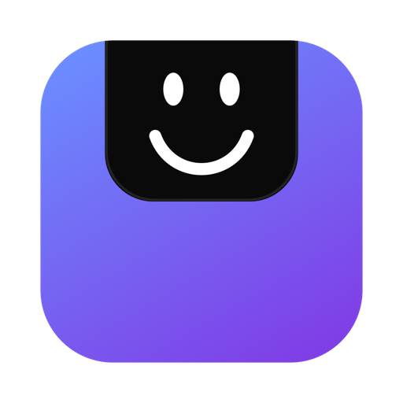
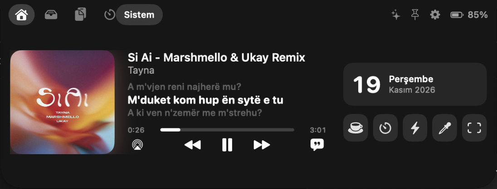
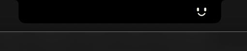

<p align="center"><a href="README.tr.md">Türkçe</a> · <a href="README.md">English</a> · <b>Deutsch</b> · <a href="README.es.md">Español</a> · <a href="README.fr.md">Français</a> · <a href="README.pt-BR.md">Português (Brasil)</a></p>

<p align="center">
  
</p>

<h1 align="center">Mate Notch</h1>

<p align="center">
  Eine leichtgewichtige macOS-App, die den MacBook-Notch in eine Steuerzentrale verwandelt: Musik mit synchronisierten Songtexten, Kalender, Zwischenablage-Verlauf, Ablage, Timer und mehr.
</p>

<p align="center">
  <a href="https://github.com/Farukzbek/Mate-Notch/releases/latest/download/Mate-Notch.dmg"><b>⬇️ Für macOS laden (Mate-Notch.dmg)</b></a><br>
  <sub>macOS 14 oder neuer · Apple Silicon und Intel · <a href="#installation">Installation</a></sub>
</p>

<p align="center">
  
</p>

## Funktionen

- **Notch-bewusst:** Liest die Größe des physischen Notch und öffnet sich beim Darüberfahren mit einer federnden Animation. Auf Macs ohne Notch zeigt er eine virtuelle Pille.
- **Musik (Apple Music + Spotify):** Cover, Fortschrittsbalken, Wiedergabe/Pause/Weiter/Zurück. Die Coverfarbe färbt den Hintergrund.
- **Synchronisierte Songtexte (Mate-Lyrics-Technik):** Drei Zeilen auf der Musikkarte (vorherige gedimmt, aktuelle hell, nächste gedimmt) und eine oder zwei Zeilen unter dem geschlossenen Notch. Bei Songs ohne Text öffnet sich der Bereich nie. Nutzt [lrclib.net](https://lrclib.net).
- **Live-Aktivitäten (im geschlossenen Zustand):** Musikanzeige, Timer, Laden, Bildschirmaufnahme. Das Anzeigesymbol ist wählbar (Equalizer, Schallwelle, AirPods, HomePod, Apple-Logo …).
- **Ablage:** Zieh eine Datei auf den Notch und zieh sie später dorthin zurück, wo du sie brauchst. Rechtsklick: Öffnen, Übersicht, in die Zwischenablage kopieren, Pfad kopieren, im Finder zeigen, per AirDrop senden.
- **Zwischenablageverlauf:** „Kopiert“-Banner beim Kopieren; Suche, Anheften (bleibt nach dem Neustart), einzeln oder gesammelt löschen, einstellbare Größe und automatisches Löschen. Kopien von Passwortmanagern werden nie gespeichert.
- **Farbpipette:** Wähle eine Farbe vom Bildschirm; der Hex-Code wird in die Zwischenablage kopiert.
- **Screenshot-Taste:** Ausgewählter Bereich, Vollbild, Bildschirmaufnahme oder das Systemwerkzeug.
- **KI:** Text aus der Zwischenablage oder eigenen Text zusammenfassen, korrigieren, umschreiben, übersetzen oder erklären; Tageszusammenfassung aus dem Kalender; freie Fragen. Standardmäßig läuft das **Apple-Modell auf dem Gerät** (kein Schlüssel nötig, Daten verlassen deinen Mac nie; erfordert Apple Intelligence). Optional verbindest du in den Einstellungen **Claude, ChatGPT oder Gemini** mit deinem eigenen API-Schlüssel; der Schlüssel liegt im Schlüsselbund.
- **AirDrop:** Zieh in der Ablage-Ansicht eine Datei auf den AirDrop-Bereich, um die Empfängerauswahl zu öffnen.
- **Cache-Bereiniger:** Listet unnötige Cache- und Protokolldateien mit ihrer Zugehörigkeit auf; ohne deine Zustimmung wird nichts gelöscht.
- **Automatische Updates:** Prüft GitHub Releases auf neue Versionen, verifiziert sie (SHA-256 + Signatur) und aktualisiert sich selbst (in den Einstellungen abschaltbar).
- **Alltag:** Eine Apple-**Kurzbefehle**-Taste, eine **Beitreten**-Taste und eine Erinnerung 5 Minuten vorher bei Meetings mit Link (Zoom, Meet, Teams …), **Pomodoro** (25/5, nach jeder 4. Pause 15), Audioausgabe-Auswahl und automatisches Leeren der Ablage nach einer gewählten Anzahl Tage.
- **Lautstärke- und Helligkeitsanzeige:** Eine schlanke Anzeige im Notch statt des quadratischen macOS-Overlays (mit Bedienungshilfen-Zugriff wird das System-Overlay ausgeblendet); Stil, Größe, Farbe, Dauer und Tastenschritt sind einstellbar.
- **Akkus und Warnungen:** Akkus von Mac, Kopfhörern, Maus und Tastatur; zweistufige Warnung bei niedrigem Akkustand; ein Banner, wenn Kopfhörer verbunden werden.
- **Fokus und Wetter:** Ein Mondsymbol, solange ein Fokus aktiv ist; das Wetter deiner gewählten Stadt (°C/°F) auf „Start“ – ohne Standortzugriff.
- **Berechtigungsassistent und Funktionstour:** Beim ersten Start wählst du eine Sprache, erteilst Berechtigungen und probierst jede Funktion einzeln aus oder überspringst sie; später über das Menü wieder aufrufbar. Nach einem Update erscheint ein Fenster **Neuigkeiten**.
- **Maskottchen (optional):** Ein kleiner Freund am rechten Flügel des geschlossenen Notch: Er greift beim Kopieren danach, winkt, wippt zur Musik, wird müde bei niedrigem Akku, setzt Kopfhörer auf, reagiert auf Extreme bei Lautstärke/Helligkeit sowie auf Meetings, Downloads und Fokus und schläft bei Inaktivität. Jedes Verhalten lässt sich einzeln ausschalten (Einstellungen › Erscheinungsbild und Maskottchen).

<p align="center"></p>

- **Sprachen:** Türkisch, Englisch, Deutsch, Spanisch, Französisch und Brasilianisches Portugiesisch (Einstellungen › Verhalten und Tabs › Sprache oder die 🌐-Taste unten in der Seitenleiste).
- **Timer, Systemstatus (CPU / Speicher / Datenträger), Wach halten, nächster Termin aus deinem Kalender.**
- **Erscheinungsbild:** Schwarz, einfarbig, Albumfarbe oder **Liquid Glass** (Dichte und Glasart einstellbar); Größe im geöffneten/geschlossenen Zustand, Auslösebereich und Verzögerungen sind einstellbar.
- **Einstellungen sichern:** Export und Import unter Einstellungen › Allgemein.
- Kurzbefehl: `⌃⌥Leertaste` blendet ihn ein/aus. Ein lächelndes Symbol in der Menüleiste; er belegt keinen Platz im Dock.

## Installation

**Mit Homebrew:**

```bash
brew tap farukzbek/tap
brew install --cask mate-notch
```

**Oder manuell:**

1. Lade [Mate-Notch.dmg](https://github.com/Farukzbek/Mate-Notch/releases/latest/download/Mate-Notch.dmg) herunter.
2. Öffne das DMG und ziehe **Mate Notch** in den Ordner **Programme**.
3. Öffne es aus „Programme“ und bestätige die Berechtigungsanfragen (Musik/Spotify, Kalender).

Die App ist mit einer Developer ID signiert und von Apple notarisiert, daher ist beim ersten Start kein zusätzlicher Schritt nötig.

Einstellungen: Menüleistensymbol › **Einstellungen …** (oder das ⚙ im geöffneten Notch).

## Aus dem Quellcode bauen

Erfordert Xcode 15+ (oder Swift-5.9+-Werkzeuge).

```bash
git clone https://github.com/Farukzbek/Mate-Notch.git
cd Mate-Notch
./build.sh              # schneller Build → „Mate Notch.app“
./build.sh --release    # Universal-App + DMG → dist/
```

## Ein Release veröffentlichen

```bash
./release.sh 1.0.0 "Release notes"
```

Das baut, signiert, notarisiert, setzt das Tag, pusht, erstellt das GitHub-Release mit `Mate-Notch.dmg` samt Prüfsumme und aktualisiert den Homebrew-Cask. Die Datei muss `Mate-Notch.dmg` heißen; der Download-Link oben verweist darauf.

Zu Signierung und Notarisierung siehe [docs/IMZA.md](docs/IMZA.md) (auf Türkisch).

## Lizenz

MIT, siehe [LICENSE](LICENSE).
