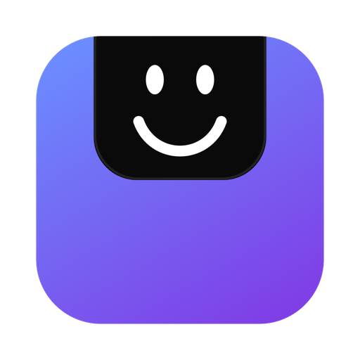
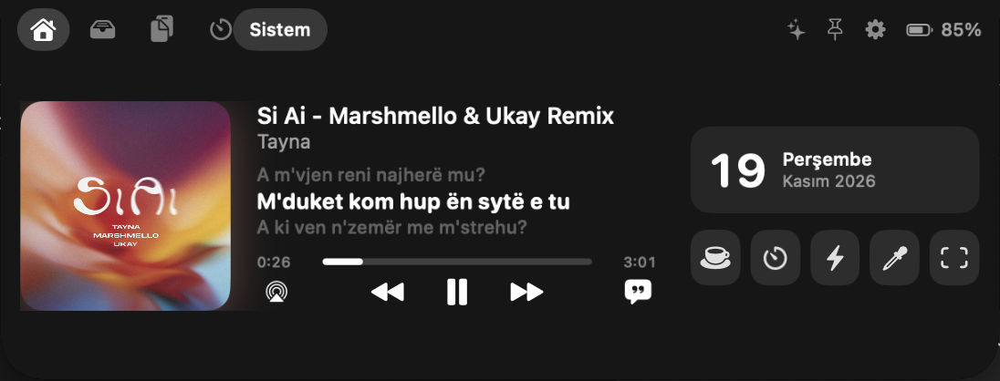
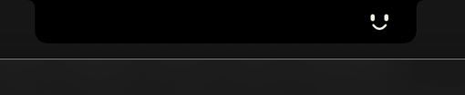

<p align="center"><a href="README.tr.md">Türkçe</a> · <a href="README.md">English</a> · <a href="README.de.md">Deutsch</a> · <b>Español</b> · <a href="README.fr.md">Français</a> · <a href="README.pt-BR.md">Português (Brasil)</a></p>

<p align="center">
  <a href="https://github.com/Farukzbek/Mate-Notch/releases/latest"></a>
  <a href="https://github.com/Farukzbek/Mate-Notch/releases"></a>
  
  
  <a href="LICENSE"></a>
  <a href="https://github.com/Farukzbek/Mate-Notch/stargazers"></a>
</p>

<p align="center">
  
</p>

<h1 align="center">Mate Notch</h1>

<p align="center">
  Una app ligera para macOS que convierte el notch del MacBook en una superficie de control: música con letras sincronizadas, calendario, historial del portapapeles, estante, temporizador y más.
</p>

<p align="center">
  <a href="https://github.com/Farukzbek/Mate-Notch/releases/latest/download/Mate-Notch.dmg"><b>⬇️ Descargar para macOS (Mate-Notch.dmg)</b></a><br>
  <sub>macOS 14 o posterior · Apple Silicon e Intel · <a href="#instalación">instalación</a></sub>
</p>

<p align="center">
  
</p>

## Funciones

- **Adaptado al notch:** Lee el tamaño del notch físico y se abre con una animación elástica al pasar el puntero. En Mac sin notch muestra una píldora virtual.
- **Música (Apple Music + Spotify):** Carátula, barra de progreso, reproducir/pausar/siguiente/anterior. El color de la carátula tiñe el fondo.
- **Letras sincronizadas (motor de Mate Lyrics):** Tres líneas en la tarjeta de música (anterior atenuada, actual brillante, siguiente atenuada) y una o dos líneas bajo el notch cerrado. En una canción sin letra el espacio nunca se abre. Usa [lrclib.net](https://lrclib.net).
- **Actividades en vivo (con el notch cerrado):** indicador de música, temporizador, carga, grabación de pantalla. El icono del indicador es elegible (ecualizador, onda de sonido, AirPods, HomePod, logo de Apple…).
- **Estante:** Arrastra un archivo al notch y luego arrástralo de vuelta adonde lo necesites. Clic derecho: Abrir, Vista rápida, copiar al portapapeles, copiar ruta, mostrar en el Finder, enviar con AirDrop.
- **Historial del portapapeles:** Banner «Copiado» al copiar; búsqueda, fijado (se mantiene tras reiniciar), eliminar uno o varios, tamaño ajustable y borrado automático. Las copias de gestores de contraseñas nunca se guardan.
- **Selector de color:** Elige un color de la pantalla y su código hex se copia al portapapeles.
- **Botón de captura:** Área seleccionada, pantalla completa, grabación de pantalla o la herramienta de captura del sistema.
- **IA:** Resume, corrige, reescribe, traduce o explica texto del portapapeles o escrito por ti; resumen diario desde el calendario; preguntas libres. Por defecto usa el **modelo de Apple en el dispositivo** (sin clave, los datos nunca salen de tu Mac; requiere Apple Intelligence). Opcionalmente conectas **Claude, ChatGPT o Gemini** con tu propia clave de API en Ajustes; la clave se guarda en el llavero.
- **AirDrop:** En la pestaña Estante, arrastra un archivo al área de AirDrop para abrir el selector de destinatario.
- **Limpiador de caché:** Enumera archivos de caché y registro innecesarios con lo que les corresponde; no se elimina nada sin tu aprobación.
- **Actualización automática:** Comprueba GitHub Releases, verifica (SHA-256 + firma) y se actualiza solo (se puede desactivar en Ajustes).
- **Uso diario:** Un botón de **Atajos** de Apple, un botón **Unirse** y un aviso 5 minutos antes en reuniones con enlace (Zoom, Meet, Teams…), **Pomodoro** (25/5, 15 cada 4.º descanso), selector de salida de audio y vaciado automático del estante tras los días que elijas.
- **Indicador de volumen y brillo:** Un indicador elegante en el notch en lugar del recuadro de macOS (con acceso a Accesibilidad se oculta el del sistema); estilo, tamaño, color, duración y paso de tecla ajustables.
- **Baterías y avisos:** Baterías de Mac, auriculares, ratón y teclado; aviso de batería baja en dos fases; un banner cuando se conectan auriculares.
- **Enfoque y tiempo:** Un icono de luna mientras hay un Enfoque activo; el tiempo de la ciudad que elijas (°C/°F) en Inicio, sin acceder a tu ubicación.
- **Asistente de permisos y recorrido de funciones:** En el primer inicio eliges idioma, concedes permisos y pruebas cada función una a una u omites; se puede reabrir desde el menú. Tras una actualización aparece una ventana de **Novedades**.
- **Mascota (opcional):** Un pequeño amigo en el ala derecha del notch cerrado: se estira a agarrar lo que copias, saluda, sigue el ritmo de la música, se cansa con batería baja, se pone auriculares, reacciona a los extremos de volumen/brillo y a reuniones, descargas y Enfoque, y duerme cuando no hay actividad. Cada comportamiento se puede desactivar por separado (Ajustes › Apariencia y mascota).

<p align="center"></p>

- **Idiomas:** turco, inglés, alemán, español, francés y portugués de Brasil (Ajustes › Comportamiento y pestañas › Idioma, o el botón 🌐 al final de la barra lateral).
- **Temporizador, estado del sistema (CPU / memoria / disco), mantener activo, próximo evento de tu calendario.**
- **Apariencia:** Negro, color sólido, color del álbum o **Liquid Glass** (densidad y tipo de cristal ajustables); tamaño abierto/cerrado, zona de activación y retardos ajustables.
- **Copia de seguridad de ajustes:** Exportar e importar desde Ajustes › General.
- **Pestaña Notas:** Un bloc de notas de una línea en el notch. Haz clic en una nota para copiarla, o envíala (o todas) a la app Notas.
- **Mezclador de audio:** Ajusta el volumen de cada app que reproduce sonido con canales verticales; un clic en el icono silencia esa app. Se recuerdan los niveles.
- **Espejo de cámara:** Usa tu cámara como espejo, haz fotos (se guardan en el Escritorio, el portapapeles y el estante) y enciende una luz anular con nivel, grosor y color ajustables (blanco, amarillo, azul). La cámara solo funciona con la pestaña abierta.
- **Pestaña Atajos:** Fija Atajos de Apple con tus propios iconos y colores y ejecútalos con un clic.
- **Guía interactiva:** Tras la configuración, una guía paso a paso resalta cada función en el notch; se reinicia cuando quieras desde el icono de la barra de menús.
- **Más música:** Un temporizador de sueño (detener tras 15–90 min o al acabar la canción), un corazón para marcar la canción como favorita en Apple Music y traducción opcional de la letra con IA al idioma de la interfaz.
- **Herramientas del estante:** Miniaturas de vista previa reales; haz clic para seleccionar y pulsa Espacio para el panel de Vista rápida de macOS (← → para navegar). Clic derecho en una imagen: convertirla (PNG, JPEG, HEIC, TIFF), reducirla o marcarla con flechas, cuadros, lápiz, resaltador y un cuadro negro para ocultar.
- **Reloj mundial y velocidad de red:** Hasta tres ciudades bajo la pestaña Sistema con la diferencia horaria, y la velocidad de descarga/subida en vivo (Mbps o MB/s).
- Atajo: `⌃⌥Espacio` lo muestra/oculta, y puedes asignar un atajo global propio a cada pestaña (Ajustes › Comportamiento y pestañas › Atajo). Un icono sonriente en la barra de menús; no ocupa sitio en el Dock.

## Instalación

**Con Homebrew:**

```bash
brew tap farukzbek/tap
brew install --cask mate-notch
```

**O manualmente:**

1. Descarga [Mate-Notch.dmg](https://github.com/Farukzbek/Mate-Notch/releases/latest/download/Mate-Notch.dmg).
2. Abre el DMG y arrastra **Mate Notch** a la carpeta **Aplicaciones**.
3. Ábrelo desde Aplicaciones y aprueba las solicitudes de permiso (Música/Spotify, Calendario).

La app está firmada con Developer ID y notarizada por Apple, por lo que no hace falta ningún paso extra en el primer inicio.

Ajustes: icono de la barra de menús › **Ajustes…** (o el ⚙ del notch abierto).

## Compilar desde el código fuente

Requiere Xcode 15+ (o herramientas de Swift 5.9+).

```bash
git clone https://github.com/Farukzbek/Mate-Notch.git
cd Mate-Notch
./build.sh              # compilación rápida → «Mate Notch.app»
./build.sh --release    # app universal + DMG → dist/
```

## Publicar una versión

```bash
./release.sh 1.0.0 "Release notes"
```

Esto compila, firma, notariza, crea la etiqueta, hace push, crea la versión de GitHub con `Mate-Notch.dmg` y su suma de comprobación, y actualiza el cask de Homebrew. El archivo debe seguir llamándose `Mate-Notch.dmg`; el enlace de descarga de arriba apunta a él.

Para la firma y la notarización consulta [docs/IMZA.md](docs/IMZA.md) (en turco).

## Apoya el proyecto

Si Mate Notch te resulta útil, una ⭐ en GitHub ayuda a que otras personas lo encuentren, y enseñárselo a un amigo ayuda aún más. Los errores y las ideas son bienvenidos en [Issues](https://github.com/Farukzbek/Mate-Notch/issues); para ayudar con código o traducciones consulta [CONTRIBUTING.md](CONTRIBUTING.md).

## Licencia

MIT, consulta [LICENSE](LICENSE).
