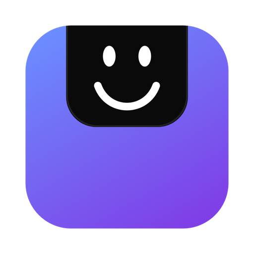
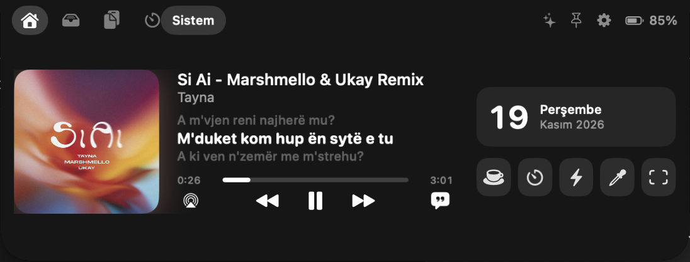
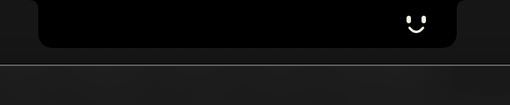

<p align="center"><a href="README.tr.md">Türkçe</a> · <a href="README.md">English</a> · <a href="README.de.md">Deutsch</a> · <a href="README.es.md">Español</a> · <b>Français</b> · <a href="README.pt-BR.md">Português (Brasil)</a></p>

<p align="center">
  
</p>

<h1 align="center">Mate Notch</h1>

<p align="center">
  Une app macOS légère qui transforme l'encoche du MacBook en surface de contrôle : musique avec paroles synchronisées, calendrier, historique du presse-papiers, étagère, minuteur et plus encore.
</p>

<p align="center">
  <a href="https://github.com/Farukzbek/Mate-Notch/releases/latest/download/Mate-Notch.dmg"><b>⬇️ Télécharger pour macOS (Mate-Notch.dmg)</b></a><br>
  <sub>macOS 14 ou ultérieur · Apple Silicon et Intel · <a href="#installation">installation</a></sub>
</p>

<p align="center">
  
</p>

## Fonctionnalités

- **Adapté au notch :** Lit la taille du notch physique et s'ouvre avec une animation élastique au survol. Sur les Mac sans encoche, il affiche une pilule virtuelle.
- **Musique (Apple Music + Spotify) :** Pochette, barre de progression, lecture/pause/suivant/précédent. La couleur de la pochette teinte l'arrière-plan.
- **Paroles synchronisées (moteur Mate Lyrics) :** Trois lignes sur la carte musique (précédente atténuée, actuelle vive, suivante atténuée) et une ou deux lignes sous le notch fermé. L'espace ne s'ouvre jamais pour un morceau sans paroles. Utilise [lrclib.net](https://lrclib.net).
- **Activités en direct (à l'état fermé) :** indicateur de musique, minuteur, charge, enregistrement d'écran. L'icône de l'indicateur est au choix (égaliseur, onde sonore, AirPods, HomePod, logo Apple…).
- **Étagère :** Faites glisser un fichier sur le notch, puis refaites-le glisser où vous voulez. Clic droit : Ouvrir, Coup d'œil, copier dans le presse-papiers, copier le chemin, afficher dans le Finder, envoyer par AirDrop.
- **Historique du presse-papiers :** Bandeau « Copié » à la copie ; recherche, épinglage (conservé au redémarrage), suppression unitaire ou groupée, taille réglable et suppression automatique. Les copies des gestionnaires de mots de passe ne sont jamais enregistrées.
- **Pipette de couleur :** Choisissez une couleur à l'écran et son code hex est copié dans le presse-papiers.
- **Bouton de capture d'écran :** Zone sélectionnée, plein écran, enregistrement d'écran ou outil de capture du système.
- **IA :** Résumez, corrigez, réécrivez, traduisez ou expliquez du texte du presse-papiers ou saisi ; résumé quotidien depuis le calendrier ; questions libres. Par défaut, le **modèle Apple sur l'appareil** est utilisé (aucune clé requise, les données ne quittent jamais votre Mac ; nécessite Apple Intelligence). En option, connectez **Claude, ChatGPT ou Gemini** avec votre propre clé API dans les Réglages ; la clé est stockée dans le trousseau.
- **AirDrop :** Dans l'onglet Étagère, faites glisser un fichier sur la zone AirDrop pour ouvrir le sélecteur de destinataire.
- **Nettoyeur de cache :** Liste les fichiers de cache et de journal inutiles avec leur origine ; rien n'est supprimé sans votre accord.
- **Mise à jour automatique :** Vérifie GitHub Releases, contrôle (SHA-256 + signature) et se met à jour seule (désactivable dans les Réglages).
- **Usage quotidien :** Un bouton **Raccourcis** Apple, un bouton **Rejoindre** et une alerte 5 minutes avant pour les réunions avec lien (Zoom, Meet, Teams…), **Pomodoro** (25/5, 15 toutes les 4 pauses), sélecteur de sortie audio et vidage automatique de l'étagère après le nombre de jours choisi.
- **Indicateur de volume et de luminosité :** Un indicateur élégant dans le notch à la place du carré de macOS (avec l'accès Accessibilité, celui du système est masqué) ; style, taille, couleur, durée et pas de touche réglables.
- **Batteries et alertes :** Batteries du Mac, du casque, de la souris et du clavier ; alerte de batterie faible en deux niveaux ; un bandeau à la connexion d'un casque.
- **Concentration et météo :** Une icône de lune pendant une Concentration ; la météo de la ville choisie (°C/°F) sur Accueil, sans accès à votre position.
- **Assistant d'autorisations et visite des fonctions :** Au premier lancement, vous choisissez la langue, accordez les autorisations et essayez chaque fonction une à une ou les passez ; rouvrable plus tard depuis le menu. Une fenêtre **Nouveautés** apparaît après une mise à jour.
- **Mascotte (facultative) :** Un petit ami sur l'aile droite du notch fermé : il tend la main pour attraper ce que vous copiez, fait coucou, bat la mesure sur la musique, se fatigue quand la batterie est faible, met un casque, réagit aux extrêmes de volume/luminosité ainsi qu'aux réunions, téléchargements et à la Concentration, et dort en cas d'inactivité. Chaque comportement se désactive séparément (Réglages › Apparence et mascotte).

<p align="center"></p>

- **Langues :** turc, anglais, allemand, espagnol, français et portugais du Brésil (Réglages › Comportement et onglets › Langue, ou le bouton 🌐 en bas de la barre latérale).
- **Minuteur, état du système (CPU / mémoire / disque), rester éveillé, prochain événement de votre calendrier.**
- **Apparence :** Noir, couleur unie, couleur de l'album ou **Liquid Glass** (densité et type de verre réglables) ; taille ouvert/fermé, zone de déclenchement et délais réglables.
- **Sauvegarde des réglages :** Exporter et importer depuis Réglages › Général.
- **Onglet Notes :** Un bloc-notes d'une ligne dans le notch. Cliquez sur une note pour la copier, ou envoyez-la (ou toutes) vers l'app Notes.
- **Plus de musique :** Un minuteur de veille (arrêt après 15–90 min ou à la fin du morceau), un cœur pour aimer le morceau dans Apple Music et une traduction facultative des paroles par IA dans la langue de l'interface.
- **Outils de l'étagère :** De vraies vignettes d'aperçu ; cliquez pour sélectionner, appuyez sur Espace pour le panneau Coup d'œil de macOS (← → pour parcourir). Clic droit sur une image : la convertir (PNG, JPEG, HEIC, TIFF), la réduire ou l'annoter avec flèches, cadres, stylo, surligneur et un cadre noir pour masquer.
- **Heure mondiale et débit réseau :** Jusqu'à trois villes sous l'onglet Système avec le décalage horaire, et le débit de téléchargement/envoi en direct (Mbit/s ou Mo/s).
- Raccourci : `⌃⌥Espace` l'affiche/le masque, et vous pouvez attribuer un raccourci global à chaque onglet (Réglages › Comportement et onglets › Raccourci). Une icône souriante dans la barre des menus ; il n'occupe aucune place dans le Dock.

## Installation

**Avec Homebrew :**

```bash
brew tap farukzbek/tap
brew install --cask mate-notch
```

**Ou manuellement :**

1. Téléchargez [Mate-Notch.dmg](https://github.com/Farukzbek/Mate-Notch/releases/latest/download/Mate-Notch.dmg).
2. Ouvrez le DMG et faites glisser **Mate Notch** dans le dossier **Applications**.
3. Ouvrez-le depuis Applications et validez les demandes d'autorisation (Musique/Spotify, Calendrier).

L'app est signée avec un Developer ID et notarisée par Apple ; aucune étape supplémentaire n'est donc nécessaire au premier lancement.

Réglages : icône de la barre des menus › **Réglages…** (ou le ⚙ du notch ouvert).

## Compiler depuis les sources

Nécessite Xcode 15+ (ou les outils Swift 5.9+).

```bash
git clone https://github.com/Farukzbek/Mate-Notch.git
cd Mate-Notch
./build.sh              # build rapide → « Mate Notch.app »
./build.sh --release    # app universelle + DMG → dist/
```

## Publier une version

```bash
./release.sh 1.0.0 "Release notes"
```

Cela compile, signe, notarise, crée le tag, pousse, crée la version GitHub avec `Mate-Notch.dmg` et sa somme de contrôle, et met à jour le cask Homebrew. Le fichier doit rester nommé `Mate-Notch.dmg` ; le lien de téléchargement ci-dessus pointe vers lui.

Pour la signature et la notarisation, voir [docs/IMZA.md](docs/IMZA.md) (en turc).

## Licence

MIT, voir [LICENSE](LICENSE).
