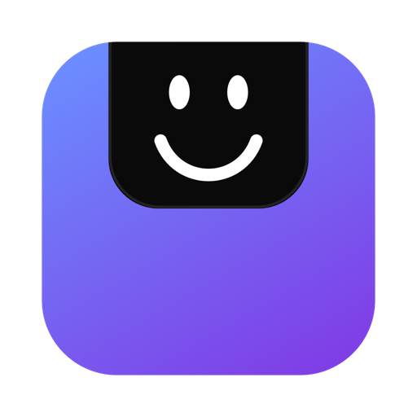

<p align="center">
  
</p>

<h1 align="center">Mate Notch</h1>

<p align="center">
  MacBook notch'unu müzik, takvim, pano ve kısayollarla dolu bir kontrol yüzeyine çeviren hafif macOS uygulaması.<br>
  <i>Turns the MacBook notch into a lightweight control surface: music with synced lyrics, calendar, clipboard history, shelf, timer and more.</i>
</p>

<p align="center">
  <a href="https://github.com/Farukzbek/Mate-Notch/releases/latest/download/Mate-Notch.dmg"><b>⬇️ macOS için indir (Mate-Notch.dmg)</b></a><br>
  <sub>macOS 14 veya üstü · Apple Silicon ve Intel · <a href="#kurulum">kurulum adımları</a></sub>
</p>

## Özellikler

- **Notch'a uyumlu:** Fiziksel notch'un ölçüsünü okur, üzerine gelince yaylı bir animasyonla açılır. Notch'u olmayan Mac'lerde sanal bir hap gösterir.
- **Müzik (Apple Music + Spotify):** Albüm kapağı, ilerleme çubuğu, oynat/duraklat/ileri/geri. Kapak rengi arka plana yansır.
- **Senkron şarkı sözleri (Mate Lyrics altyapısı):** Müzik kartında 3 satır (önceki sönük, anlık parlak, sonraki sönük), kapalı notch'un altında 1 veya 2 satır. Sözü olmayan şarkıda alan hiç açılmaz. [lrclib.net](https://lrclib.net) kullanır.
- **Canlı etkinlikler (kapalıyken):** müzik göstergesi, zamanlayıcı, şarj, ekran kaydı. Gösterge simgesi seçilebilir (equalizer, ses dalgası, AirPods, HomePod, Apple logosu…).
- **Raf:** Dosyayı notch'a sürükle, sonra istediğin yere geri sürükle.
- **Pano geçmişi:** Kopyalayınca "Kopyalandı" bandı; tek tek veya toplu silme. Şifre yöneticisi kopyaları kaydedilmez.
- **Renk seçici:** Ekrandan bir rengi seç, hex kodu panoya kopyalansın.
- **Ekran görüntüsü düğmesi:** Seçilen alan, tam ekran, video kaydı veya sistem çekim aracı.
- **Yapay zeka:** Panodaki veya yazdığın metni özetle, düzelt, yeniden yaz, çevir, açıkla; takvimden günlük özet; serbest soru. Varsayılan olarak **cihaz içi Apple modeliyle** çalışır (anahtar gerekmez, veri Mac'inden çıkmaz; Apple Intelligence gerekir). İstersen Ayarlar'dan **Claude, ChatGPT veya Gemini** hesabını (kendi API anahtarınla) bağlarsın; anahtar Anahtarlık'ta saklanır.
- **AirDrop:** Raf sekmesinde dosyayı AirDrop alanına sürükle, alıcı seçici açılsın.
- **Önbellek temizleyici:** Gereksiz önbellek ve günlük dosyalarını neye ait olduklarını yazarak listeler; sen onaylamadan hiçbir şey silmez.
- **Otomatik güncelleme:** GitHub Releases'te yeni sürüm çıkınca denetler, doğrular (SHA-256 + imza) ve kendini günceller (ayarlardan kapatılabilir).
- **Zamanlayıcı, sistem durumu (CPU / bellek / disk), uyanık tut, takvimde sıradaki etkinlik.**
- **Görünüm:** Siyah, düz renk, albüm rengi veya **Liquid Glass** (yoğunluk ve cam tipi ayarlı); açık/kapalı boyut, açılma alanı ve gecikmeleri ayarlanabilir.
- Kısayol: `⌃⌥Space` aç/kapat. Menü çubuğunda gülen yüzlü simge; Dock'ta yer kaplamaz.

## Kurulum

1. [Mate-Notch.dmg](https://github.com/Farukzbek/Mate-Notch/releases/latest/download/Mate-Notch.dmg) dosyasını indir.
2. DMG'yi aç, **Mate Notch**'u **Uygulamalar** klasörüne sürükle.
3. Uygulamalar'dan aç. İzin isteklerini (Müzik/Spotify, Takvim) onayla.

> **İlk açılışta macOS uyarı verirse:** Uygulama henüz Apple tarafından onaylanmış (notarize) değil. **Sistem Ayarları › Gizlilik ve Güvenlik** sayfasında en altta **"Yine de Aç"** düğmesine bas. Bu işlem yalnızca bir kez gerekir.

Ayarlar: menü çubuğundaki simge › **Ayarlar…** (veya açık notch'taki ⚙).

## Kaynaktan derleme

Xcode 15+ (veya Swift 5.9+ araçları) gerekir.

```bash
git clone https://github.com/Farukzbek/Mate-Notch.git
cd Mate-Notch
./build.sh              # hızlı derleme → "Mate Notch.app"
./build.sh --release    # evrensel uygulama + DMG → dist/
```

## Sürüm yayınlama

```bash
VERSION=1.0.0 ./build.sh --release     # dist/Mate-Notch.dmg üretir
```

`dist/Mate-Notch.dmg` dosyasını GitHub **Releases** sayfasına yükle (dosya adı `Mate-Notch.dmg` kalmalı; README'deki indirme bağlantısı buna işaret eder).
Apple Developer ID sertifikan varsa `SIGN_ID="Developer ID Application: …" ./build.sh --release` ile imzalayabilir, notarize edince yukarıdaki "Yine de Aç" uyarısı kalkar.

## Lisans

MIT — bkz. [LICENSE](LICENSE).
