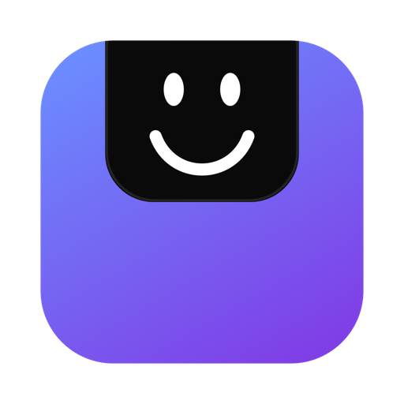
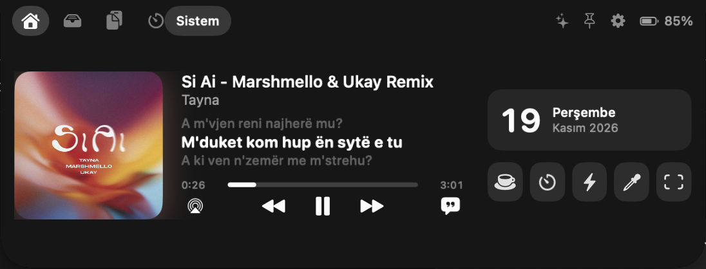
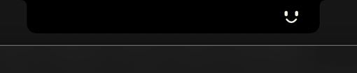

<p align="center"><a href="README.tr.md">Türkçe</a> · <a href="README.md">English</a> · <a href="README.de.md">Deutsch</a> · <a href="README.es.md">Español</a> · <a href="README.fr.md">Français</a> · <b>Português (Brasil)</b></p>

<p align="center">
  <a href="https://github.com/Farukzbek/Mate-Notch/releases/latest"></a>
  <a href="https://github.com/Farukzbek/Mate-Notch/releases"></a>
  
  
  <a href="LICENSE"></a>
  <a href="https://github.com/Farukzbek/Mate-Notch/stargazers"></a>
</p>

<p align="center">
  
</p>

<h1 align="center">Mate Notch</h1>

<p align="center">
  Um app leve para macOS que transforma o notch do MacBook em uma superfície de controle: música com letras sincronizadas, calendário, histórico da área de transferência, prateleira, timer e muito mais.
</p>

<p align="center">
  <a href="https://github.com/Farukzbek/Mate-Notch/releases/latest/download/Mate-Notch.dmg"><b>⬇️ Baixar para macOS (Mate-Notch.dmg)</b></a><br>
  <sub>macOS 14 ou superior · Apple Silicon e Intel · <a href="#instalação">instalação</a></sub>
</p>

<p align="center">
  
</p>

## Recursos

- **Ciente do notch:** Lê o tamanho do notch físico e abre com uma animação elástica ao passar o ponteiro. Em Macs sem notch, mostra uma pílula virtual.
- **Música (Apple Music + Spotify):** Capa, barra de progresso, tocar/pausar/próxima/anterior. A cor da capa tinge o fundo.
- **Letras sincronizadas (motor do Mate Lyrics):** Três linhas no cartão de música (anterior esmaecida, atual brilhante, próxima esmaecida) e uma ou duas linhas sob o notch fechado. Em uma música sem letra, a área nunca abre. Usa o [lrclib.net](https://lrclib.net). Uma linha fina ao lado da letra mostra em que ponto você está; ao rolar, ela também marca a linha que está tocando.
- **Atividades ao vivo (com o notch fechado):** indicador de música, timer, carregamento, gravação de tela. O ícone do indicador é selecionável (equalizador, onda sonora, AirPods, HomePod, logo da Apple…).
- **Prateleira:** Arraste um arquivo para o notch e depois arraste de volta para onde precisar. Clique com o botão direito: Abrir, Visualização rápida, copiar para a área de transferência, copiar caminho, mostrar no Finder, enviar por AirDrop.
- **Histórico da área de transferência:** Faixa “Copiado” ao copiar; busca, fixação (permanece após reiniciar), excluir um ou vários, tamanho ajustável e exclusão automática. Cópias de gerenciadores de senhas nunca são salvas.
- **Seletor de cor:** Escolha uma cor da tela e o código hex é copiado para a área de transferência.
- **Botão de captura de tela:** Área selecionada, tela inteira, gravação de tela ou a ferramenta de captura do sistema.
- **IA:** Resuma, corrija, reescreva, traduza ou explique textos da área de transferência ou digitados; resumo do dia a partir do calendário; perguntas livres. Por padrão roda o **modelo da Apple no dispositivo** (sem chave, os dados nunca saem do seu Mac; requer Apple Intelligence). Opcionalmente, conecte **Claude, ChatGPT ou Gemini** com sua própria chave de API nos Ajustes; a chave fica no Chaves.
- **AirDrop:** Na aba Prateleira, arraste um arquivo para a área do AirDrop para abrir o seletor de destinatário.
- **Limpador de cache:** Lista arquivos de cache e de log desnecessários e a quem pertencem; nada é excluído sem a sua aprovação.
- **Atualização automática:** Verifica o GitHub Releases, confere (SHA-256 + assinatura) e se atualiza sozinho (pode ser desativado nos Ajustes).
- **Uso diário:** Um botão de **Atalhos** da Apple, um botão **Entrar** e um aviso 5 minutos antes em reuniões com link (Zoom, Meet, Teams…), **Pomodoro** (25/5, 15 a cada 4ª pausa), seletor de saída de áudio e limpeza automática da prateleira após os dias escolhidos.
- **Indicador de volume e brilho:** Um indicador elegante no notch no lugar do quadrado do macOS (com acesso à Acessibilidade, o do sistema é ocultado); estilo, tamanho, cor, duração e passo da tecla ajustáveis.
- **Baterias e alertas:** Baterias de Mac, fones, mouse e teclado; alerta de bateria fraca em dois níveis; uma faixa quando fones se conectam.
- **Foco e clima:** Um ícone de lua enquanto um Foco está ativo; o clima da cidade escolhida (°C/°F) em Início, sem acessar sua localização.
- **Assistente de permissões e tour de recursos:** Na primeira abertura, você escolhe o idioma, concede permissões e experimenta cada recurso um a um ou pula; pode reabrir depois pelo menu. Uma janela de **Novidades** aparece após uma atualização.
- **Mascote (opcional):** Um amiguinho na asa direita do notch fechado: ele estica o braço para pegar o que você copia, acena, marca o ritmo da música, fica cansado com bateria fraca, coloca fones, reage a extremos de volume/brilho e a reuniões, downloads e Foco, e dorme quando não há atividade. Cada comportamento pode ser desativado separadamente (Ajustes › Aparência e mascote).

<p align="center"></p>

- **Idiomas:** turco, inglês, alemão, espanhol, francês e português do Brasil (Ajustes › Comportamento e abas › Idioma, ou o botão 🌐 no fim da barra lateral).
- **Timer, status do sistema (CPU / memória / disco), manter ativo, próximo evento do seu calendário.**
- **Aparência:** Preto, cor sólida, cor do álbum ou **Liquid Glass** (densidade e tipo de vidro ajustáveis); tamanho aberto/fechado, área de ativação e atrasos ajustáveis.
- **Backup dos ajustes:** Exportar e importar em Ajustes › Geral.
- **Aba Notas:** Um bloco de notas de uma linha no notch. Clique em uma nota para copiá-la, ou envie-a (ou todas) para o app Notas.
- **Mixer de áudio:** Ajuste o volume de cada app que toca som com canais verticais; um clique no ícone silencia o app. Os níveis são lembrados.
- **Espelho da câmera:** Use sua câmera como espelho, tire fotos (salvas na Mesa, na área de transferência e na prateleira) e ligue um anel de luz com nível, espessura e cor ajustáveis (branco, amarelo, azul). A câmera só funciona com a aba aberta.
- **Aba Atalhos:** Fixe Atalhos da Apple com seus próprios ícones e cores e execute com um clique.
- **Guia interativo:** Após a configuração, um guia passo a passo destaca cada recurso no notch; pode ser reiniciado a qualquer momento pelo ícone da barra de menus.
- **Mais música:** Um timer de sono (parar após 15–90 min ou ao fim da música), um coração para curtir a música no Apple Music e tradução opcional da letra com IA para o idioma da interface.
- **Ferramentas da prateleira:** Miniaturas de pré-visualização reais; clique para selecionar e pressione Espaço para o painel de Visualização rápida do macOS (← → para navegar). Clique com o botão direito em uma imagem: converter (PNG, JPEG, HEIC, TIFF), reduzir ou marcar com setas, caixas, caneta, marca-texto e uma caixa preta para ocultar.
- **Relógio mundial e velocidade de rede:** Até três cidades na aba Sistema com a diferença de horário, e a velocidade de download/upload ao vivo (Mbps ou MB/s).
- Atalho: `⌃⌥Espaço` mostra/oculta, e você pode atribuir um atalho global próprio a cada aba (Ajustes › Comportamento e abas › Atalho). Um ícone sorridente na barra de menus; não ocupa espaço no Dock.

## Instalação

**Com o Homebrew:**

```bash
brew tap farukzbek/tap
brew install --cask mate-notch
```

**Ou manualmente:**

1. Baixe o [Mate-Notch.dmg](https://github.com/Farukzbek/Mate-Notch/releases/latest/download/Mate-Notch.dmg).
2. Abra o DMG e arraste o **Mate Notch** para a pasta **Aplicativos**.
3. Abra-o em Aplicativos e aprove os pedidos de permissão (Música/Spotify, Calendário).

O app é assinado com um Developer ID e notarizado pela Apple, então nenhuma etapa extra é necessária na primeira abertura.

Ajustes: ícone da barra de menus › **Ajustes…** (ou o ⚙ no notch aberto).

## Compilar a partir do código-fonte

Requer Xcode 15+ (ou ferramentas do Swift 5.9+).

```bash
git clone https://github.com/Farukzbek/Mate-Notch.git
cd Mate-Notch
./build.sh              # compilação rápida → “Mate Notch.app”
./build.sh --release    # app universal + DMG → dist/
```

## Publicar uma versão

```bash
./release.sh 1.0.0 "Release notes"
```

Isso compila, assina, notariza, cria a tag, faz push, cria a versão do GitHub com o `Mate-Notch.dmg` e sua soma de verificação, e atualiza o cask do Homebrew. O arquivo deve continuar se chamando `Mate-Notch.dmg`; o link de download acima aponta para ele.

Para assinatura e notarização, veja [docs/IMZA.md](docs/IMZA.md) (em turco).

## Apoie o projeto

Se o Mate Notch é útil para você, uma ⭐ no GitHub ajuda outras pessoas a encontrá-lo, e mostrá-lo a um amigo ajuda ainda mais. Erros e ideias são bem-vindos em [Issues](https://github.com/Farukzbek/Mate-Notch/issues); para ajudar com código ou traduções, veja [CONTRIBUTING.md](CONTRIBUTING.md).

## Licença

MIT, veja [LICENSE](LICENSE).
